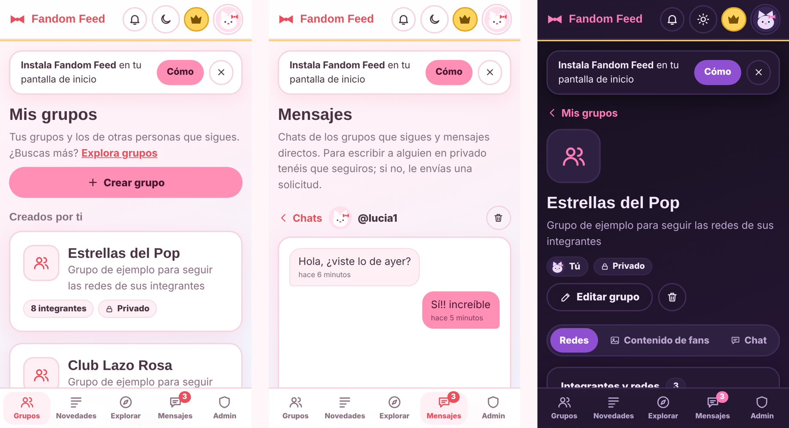
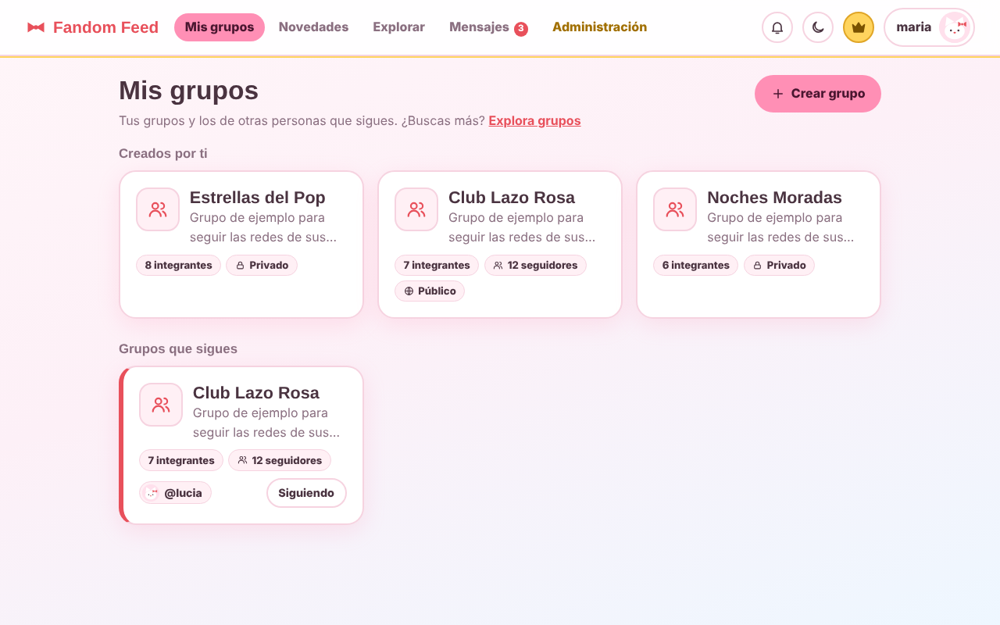
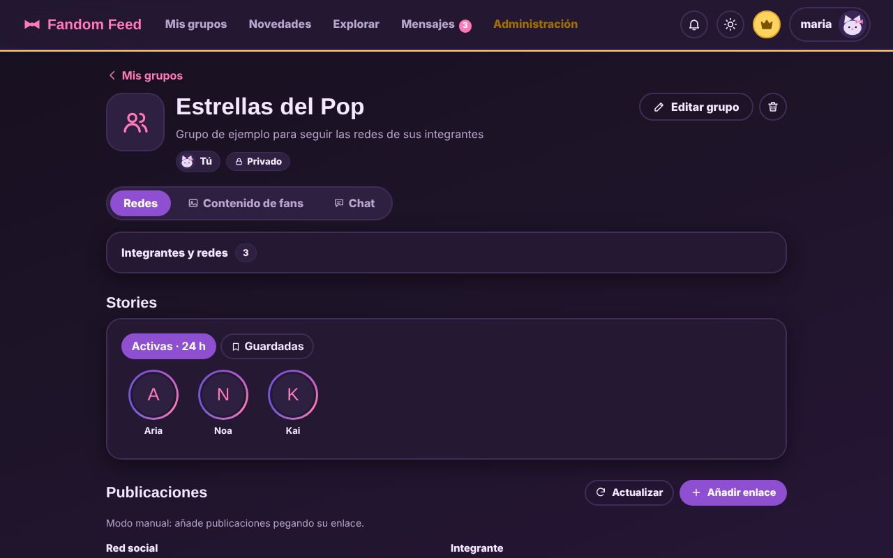
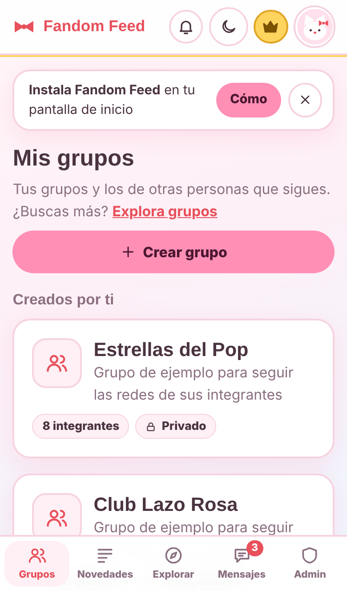
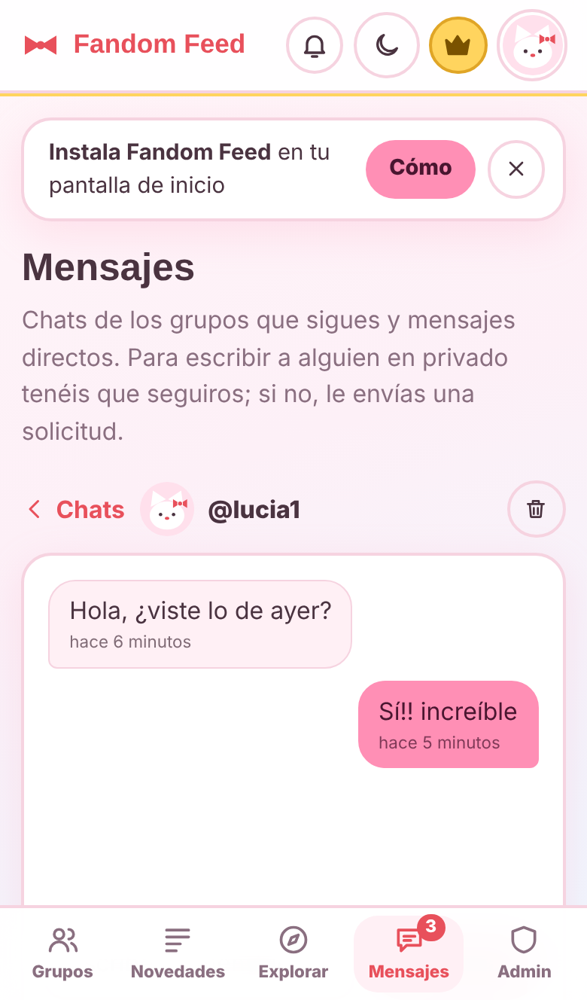
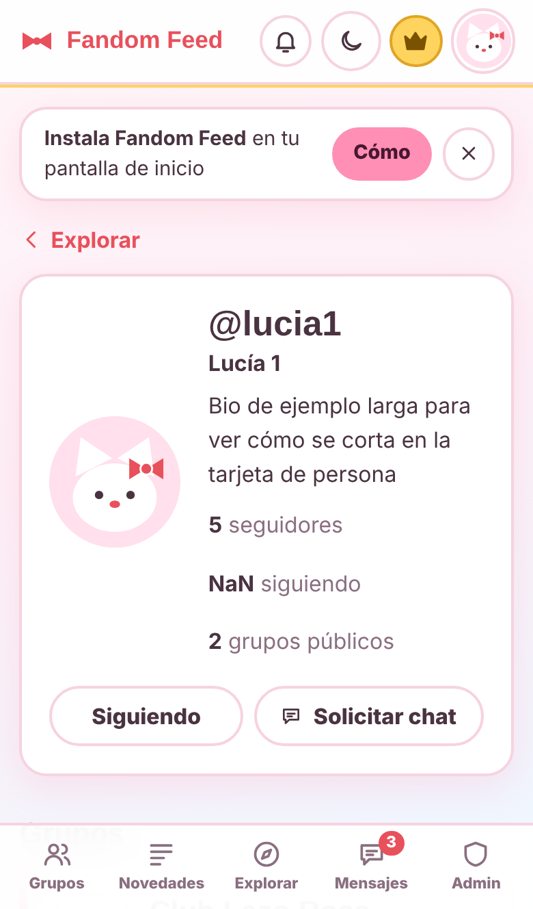
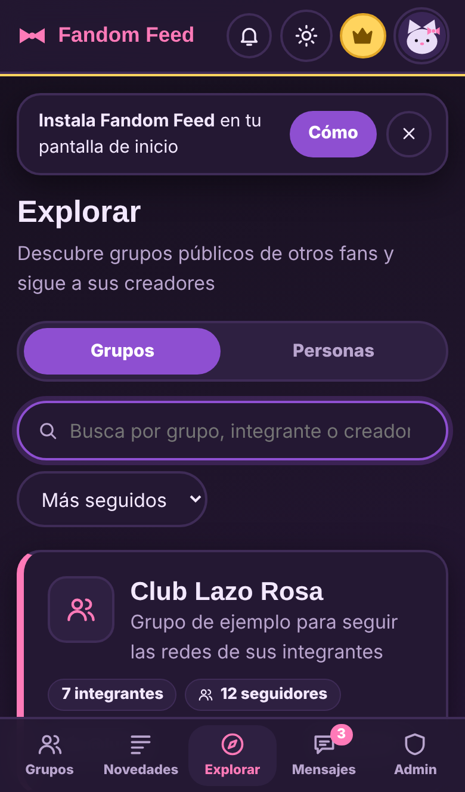
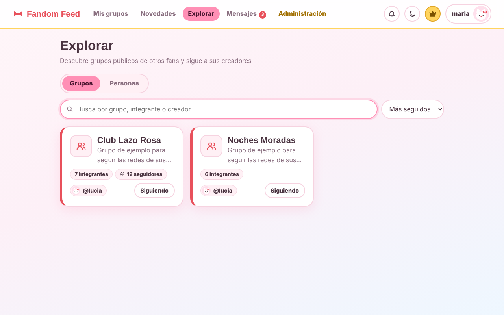

# Fandom Feed

**Todo tu fandom en un solo sitio.** 
Sigue las redes de los integrantes que te gustan, comparte grupos con otras personas y charla con ellas, desde el ordenador o desde el móvil como una app.

**[Abrir la app → https://fandom-feed.vercel.app/](https://fandom-feed.vercel.app/)** · _acceso solo con invitación_

---

## ✨ Qué puedes hacer

| | |
|---|---|
| 🎀 **Grupos de fandom** | Crea un grupo, añade a sus integrantes y guarda su Instagram y su X. Público (cualquiera lo encuentra y lo sigue) o privado (solo tú). |
| 📖 **Stories como en Instagram** | Un círculo por persona con stories de las últimas 24 h. Al acabar las de una, pasa solo a la siguiente; las ya vistas se ponen al final, en gris. Guarda las que quieras: solo tú las ves. |
| 📰 **Novedades** | Las publicaciones más recientes de todos los grupos que sigues, en un único hilo y con botón directo a la publicación original. |
| 🔎 **Explorar** | Busca grupos y personas, sigue a quien te interese y copia el grupo de otra persona a tu cuenta. |
| 💬 **Chats** | Un chat por grupo y mensajes directos entre personas que se siguen mutuamente (con solicitud si aún no). |
| 🖼️ **Contenido de fans** | Cada creadora/or sube sus edits o fanfics y decide si los ve todo el mundo o solo quien tenga acceso. |
| 🔔 **Notificaciones** | Seguidores nuevos, comentarios, solicitudes de chat… un toque y vas al perfil. |
| 🌗 **Dos estilos** | Claro _Hello Kitty_ (rosa pastel) y oscuro _Kuromi_ (morados). |
| 📱 **App en el móvil** | Se instala en la pantalla de inicio y se actualiza sola. |

---

## 🚀 Cómo empezar

1. **Pide tu código de invitación** a quien administra la web. Cada código sirve para crear **una sola cuenta**. Instagram: @maariaaledesmaa !
2. Entra en la web → **Crear cuenta**, escribe el código (o abre el enlace de invitación, que ya lo rellena), tu usuario, email y contraseña.
3. **Crea tu primer grupo** («Crear grupo»): nombre, foto, integrantes y sus usuarios de Instagram / X.
4. Pulsa **Actualizar** dentro del grupo para traer lo último. Las publicaciones salen debajo y las stories arriba.
5. Mira **Explorar** para seguir grupos y personas, y **Mensajes** para charlar.

> 💡 El contenido se actualiza cuando pulsas _Actualizar_ en un grupo (así se cuida el límite gratuito de consultas).

---

## 📲 Instalar como app (PWA)

Fandom Feed es una **PWA**: se abre a pantalla completa, con su icono, y **se actualiza sola** cada vez que se publica una versión nueva (verás un aviso «Hay una versión nueva · Actualizar»). No ocupa casi nada y no pasa por ninguna tienda de aplicaciones.

### 🤖 Android (Chrome)
1. Abre la web en **Chrome**.
2. Pulsa **Instalar** en el aviso que aparece arriba (o en tu perfil → _Instala la app_). También vale el menú **⋮ → Instalar aplicación**.
3. Confirma. El icono aparecerá en tu pantalla de inicio y en el cajón de aplicaciones.

### 🍎 iPhone / iPad (Safari)
1. Abre la web en **Safari** (no funciona desde Chrome en iOS).
2. Toca el botón **Compartir** (el cuadrado con la flecha hacia arriba).
3. Desliza y elige **Añadir a pantalla de inicio** → **Añadir**.
4. Abre Fandom Feed desde el nuevo icono.

### 💻 Ordenador
En Chrome o Edge, pulsa el icono de **instalar** que aparece a la derecha de la barra de direcciones.

---

## 🔒 Privacidad

- Un grupo privado **solo lo ve su creadora/or**; esto lo garantiza la base de datos, no solo la pantalla.
- Tu email no aparece en ningún perfil ni listado.
- Las stories que guardas son solo tuyas. Quien administra la web **no puede leer tus mensajes directos**.
- El registro es **solo con invitación** y cada código se consume al crear la cuenta.

---

## 🛠️ Para el currículum: qué hay detrás

Proyecto personal de principio a fin, pensado para **coste cero** y uso real con amistades.

| Área | Qué se ha hecho |
|---|---|
| **Frontend** | React 18 + Vite, React Router, CSS propio con temas claro/oscuro, accesibilidad (roles ARIA, foco, tamaños táctiles ≥ 44 px) y diseño **responsive**: escritorio completo y móvil con barra de pestañas, hojas inferiores y áreas seguras (_notch_). |
| **PWA** | Manifiesto, iconos _maskable_, service worker «red primero» que solo toca lo del propio origen, aviso de versión nueva por `version.json` generado en cada build, instalación en Android e iOS. |
| **Backend** | Supabase: PostgreSQL con **Row Level Security**, funciones `SECURITY DEFINER`, _triggers_, Storage con políticas por carpeta y Realtime para los chats. |
| **Seguridad** | Permisos en la base de datos, registro por **códigos de un solo uso** consumidos de forma atómica (probado con registros simultáneos), roles de administración y secretos solo en servidor. |
| **Integraciones** | Funciones _serverless_ (Deno/Edge Functions) que consultan Apify con caché, presupuesto de gasto, reintentos y rotación de claves. |
| **Calidad** | 56 pruebas automáticas de la función de servidor, más baterías de pruebas SQL con varios roles y revisión visual en navegador real. |
| **DevOps** | Despliegue continuo en Vercel: cada `git push` publica la web y la PWA. |

Más capturas

 

  

---

## ⚖️ Aviso

Proyecto personal sin ánimo de lucro, no afiliado a Instagram, X ni a ningún artista. Las publicaciones se muestran enlazando a su origen.
Todos los derechos reservados sobre el código y el diseño (ver `LICENSE`).
